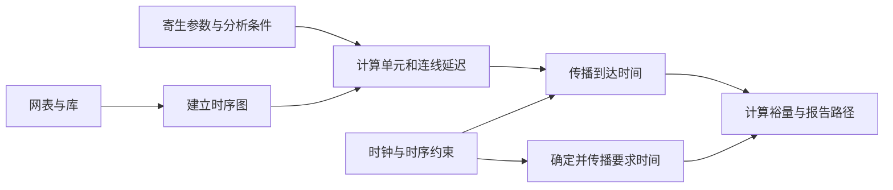

# STA 模块总览：判断信号能否在规定时间内到达

`sta` 对应 OpenSTA 静态时序分析引擎。它结合电路连接、单元延迟、导线寄生参数和时序约束，判断信号到达是否满足要求，并报告关键路径和时间裕量。它是布局、时钟树和电路优化反复使用的分析基础。

本文依据 OpenROAD 提交 `a5a08e8356` 及其 OpenSTA 子模块提交 `65bd9df5` 的文档与源码编写。命令手册见 [OpenSTA 文档](../src/sta/doc/OpenSTA.pdf)。本文暂存于主仓库 `docs/`；根据项目规则，新增到 `src/sta/docs/` 前需要获得许可。

## 1. 为什么需要静态时序分析？

逻辑功能正确，只说明电路在正确输入下能够算出正确结果。同步电路还要求结果在规定时间到达：寄存器按照时钟采样，数据太晚或太早都可能出错。

假设一条路径从寄存器 A 出发，经过几个逻辑门和导线，到达寄存器 B。每个单元、每段导线都需要传播时间，A 和 B 收到时钟的时间也可能不同。STA 将这些因素放在一起，检查 B 能否正确接收数据。

“静态”表示主要根据结构、模型和约束分析时序，而不依赖逐个输入测试向量模拟每次运行。STA 不会自动证明电路逻辑功能正确，也不能替代所有跨时钟域或模拟电路行为验证。

## 2. 首先理解四个量

| 概念 | 含义 |
| --- | --- |
| Arrival time：到达时间 | 在选定参考时钟和分析条件下，信号传播到某点的时间。 |
| Required time：要求时间 | 为满足相应检查，信号最晚或最早应到达的时间界限。 |
| Slack：裕量 | 到达时间距离检查界限还剩多少余量；负值表示违例。 |
| Critical path：关键路径 | 在当前分析范围和检查条件下裕量最紧张的路径。 |

**Setup 检查数据会不会太晚。** 在简化情形下，setup slack = 最晚允许到达时间 − 最晚实际到达时间。例如要求不晚于 1.0 ns，而数据在 1.1 ns 到达，则裕量为 −0.1 ns。

**Hold 检查新数据会不会太早。** 在简化情形下，hold slack = 最早实际到达时间 − 最早允许到达时间。例如数据必须保持到 0.2 ns，新数据却在 0.1 ns 到达，则裕量为 −0.1 ns。

这些数值只是概念示例。实际要求时间还取决于发射与捕获时钟、单元 setup/hold 要求、不确定度和路径例外等，不能对所有路径简单使用“周期减总延迟”。

## 3. 输入和输出

| 输入 | 提供什么 |
| --- | --- |
| 门级网表 | 逻辑单元、引脚和连接，决定信号可能经过的路径。 |
| Liberty 库 | 单元的时序弧、延迟模型、转换时间和时序检查要求。 |
| SDC 约束 | 时钟、输入输出延迟、时钟不确定度、路径例外等设计要求。 |
| 寄生参数或延迟标注 | 描述导线电阻、电容或已知延迟，例如 SPEF 寄生数据、SDF 延迟标注。 |
| 分析条件 | 工艺、电压、温度等分析角，以及需要检查的工作场景。 |

在 OpenROAD 内，OpenSTA 通过 `dbSta` 接入 OpenDB 中的连接；独立运行时也可以自行读入相应文件。仅有物理坐标并不能直接提供完整导线 RC，需要寄生估计或提取环节提供模型。

主要输出是**路径报告、到达和要求时间、slack、WNS/TNS 以及相关时序与电气检查结果**。WNS 反映最严重的负裕量；TNS 汇总违例端点的负裕量，用于观察整体违例程度。OpenSTA 也具有功耗分析能力，但时序分析是理解本模块的首要内容。

## 4. 核心工作：建图、算延迟、传播时间

**建时序图。** 图中的节点主要对应引脚及其分析表示，边表达单元内部的时序弧和网络连接。图还需要区分信号传播与寄存器等对象的检查关系。

**算延迟和信号边沿。** 单元延迟随输入边沿、输出负载和分析条件变化。导线也有延迟，并影响驱动端看到的负载，因此不能为每个逻辑门简单指定一个永远不变的时间。

**传播不同条件下的时间。** 分析同时涉及早到与晚到、上升与下降、不同发射时钟及例外约束。时序引擎要保留相关上下文，避免把本不属于同一检查场景的时间混在一起。

**增量更新。** 布局优化或 RSZ 只修改一部分电路时，可以使受影响的数据失效并重新计算，而不必每次从零分析全部设计。其正确性依赖编辑通知、寄生更新与缓存维护，`dbSta` 在 OpenROAD 集成中负责重要的衔接工作。

## 5. 典型场景与容易误判的结果

**布局阶段评估路径。** 先用布局估计的导线 RC 判断哪些连接紧张，再指导放置和单元调整。

**CTS 后分析真实时钟影响。** 理想时钟是一种早期模型；传播时钟把实际时钟网络延迟纳入分析。两端时钟到达时间不同，setup 和 hold 都可能变化。

**布线后重新检查。** 使用更准确的寄生参数，确认实际路线、过孔和负载是否改变了早期结论。

最常见的误判之一是“没有报告违例，就说明设计全部满足要求”。如果遗漏了时钟、输入输出约束，或错误设置了 false path（不进行相应路径检查的例外），某些路径可能根本没有得到预期检查。应先检查约束覆盖，再解释裕量。

另一个误判是“只要降低时钟频率就能解决所有时序问题”。放宽周期通常有助于 setup；hold 关心数据过早到达，在常见同边沿寄存器路径上并不能靠放慢时钟直接解决。

STA 分析结果适用于输入的模型、约束和场景。它负责发现问题；移动单元、插入缓冲器或修改时钟树的动作，由 `gpl`、`rsz`、`cts` 等实现模块完成。

## 6. 三类角色的后续学习路径

- **OpenROAD 工具使用者：** 从 [OpenSTA 手册](../src/sta/doc/OpenSTA.pdf) 学会读一条 setup 和一条 hold 路径，逐段辨认时钟、单元延迟、连线延迟和裕量。再比较布局估计、全局布线估计与提取寄生下的结果，同时核查约束覆盖。
- **OpenROAD 其他模块开发者：** 先读 [StaApi.txt](../src/sta/doc/StaApi.txt) 与 [dbSta 总览](../src/dbSta/docs/dbSta-overview.md)，掌握分析单位、对象生命周期和增量失效。优先通过 `Sta` 层协调接口操作，避免只重算延迟却保留依赖它的旧到达时间。
- **STA 模块开发者：** 按 [network](../src/sta/network) → [graph](../src/sta/graph) → [dcalc](../src/sta/dcalc) → [search](../src/sta/search) 阅读，并结合 [sdc](../src/sta/sdc) 和 [parasitics](../src/sta/parasitics) 理解约束与 RC。重点验证多时钟、早晚分析、条件弧、例外路径及增量结果的一致性；涉及源码变更时遵循 OpenSTA 的上游维护规则。
