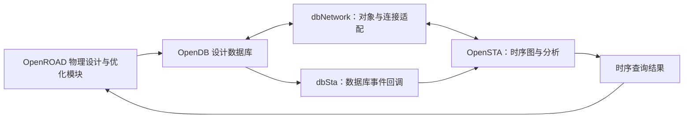

# dbSta 模块总览：让物理数据库与时序分析使用同一个设计

`dbSta` 是 OpenDB 与 OpenSTA 之间的集成层。它让时序分析器能够理解物理设计数据库里的单元、引脚和连接，并在电路被修改时收到必要的更新通知。很多用户不会单独“运行 dbSta”，却会在读入设计、查询时序和优化电路时持续使用它。

本文依据 OpenROAD 提交 `a5a08e8356` 的源码编写。理解它之前，只需知道：**网表描述谁与谁相连，物理数据库还记录这些对象放在哪里，时序分析判断信号能否按时到达。**

## 1. 为什么需要这一层？

OpenDB 和 OpenSTA 面向不同问题。OpenDB 管理单元实例、引脚、导线、层次等设计对象；OpenSTA 需要遍历连接、查询单元的延迟模型并计算路径时间。两者对“一个引脚”的表示和操作接口并不相同。

如果每次优化都导出网表，再启动一个独立时序工具，数据交换会很慢，也容易出现“物理设计已经改了，时序工具仍在分析旧电路”的问题。dbSta 通过适配接口，使 OpenSTA 能直接访问宿主数据库中的连接关系，无需为分析再维护一份独立的完整宿主网表。

这不代表时序引擎没有自己的数据：时序图、延迟、约束和分析缓存仍由 OpenSTA 管理。dbSta 的关键责任是让这些数据与当前设计保持一致。

## 2. 输入和输出

| 输入 | 提供什么 |
| --- | --- |
| OpenDB 设计对象 | 单元实例、端口、网络、物理位置以及平面或层次连接。 |
| Liberty 单元库 | 单元的逻辑功能、时序弧和电气特性；时序弧描述信号经过单元或时序检查的关系。 |
| OpenSTA 的约束与分析环境 | 时钟、输入输出延迟、分析角和路径例外等。分析角表示某组工艺、电压、温度及相关模型条件。 |
| 网表编辑与数据库生命周期事件 | 读入设计、新建或删除实例、替换单元、连接或断开引脚等操作。 |
| 由流程提供的寄生参数 | 导线电阻、电容等，用于实际时序计算；其生成并非仅靠对象适配完成。 |

输出主要是**可供 STA 使用的数据库视图、对象映射及同步后的分析状态**。上层可以据此查询 slack、关键路径或时钟网络。slack 即时间裕量，负值通常表示相应检查存在违例。

dbSta 的“输出”往往存在于内存和 API 中，不一定是一份新文件。它也包含设计读入和报告等集成功能；完整时序计算的核心仍在 `sta`。

## 3. 核心结构：适配、关联、通知

**对象适配。** `dbNetwork` 实现 OpenSTA 的网络访问接口：一个实例有哪些引脚，一个网络连接哪些端点，一个库单元对应哪个物理 master。master 是单元模板，instance 是该模板在设计中的一次使用。源码中的 `dbToSta`、`staToDb` 等接口表达了这种映射。

**物理库与时序库的关联。** LEF 主要描述单元尺寸、引脚形状和工艺几何；Liberty 描述逻辑与时序特性。两者通常共同描述同一类单元，但需要正确匹配。只有几何信息、没有有效的时序模型，不能支持完整时序判断。

**编辑通知。** 以插入缓冲器为例：新实例产生，原网络被拆分，若干引脚重新连接。数据库回调把这些变化通知时序引擎，使相应图结构或缓存得到维护、失效或后续增量更新。删除前与创建后的通知有不同用途，次序错误可能让分析继续引用已失效对象。

**层次语义。** 层次网表中，顶层端口、模块端口和叶子单元引脚具有不同身份。用户看到的路径名、数据库对象和时序遍历需要指向一致的连接。调试时不能简单把所有端点都当作普通标准单元引脚。

## 4. 典型场景：为什么改了电路，报告却没变？

假设优化器把弱驱动单元换成强驱动版本。正常情况下，时序查询应使用新单元的库模型；若还沿用旧关联或旧延迟，工具可能误判优化无效。

排查应沿着事实链展开：数据库里的 master 是否真的替换，Liberty 是否存在对应单元，编辑通知是否执行，受影响的时序状态是否更新。若修改还涉及位置或导线，需进一步确认寄生参数是否重算。**连接通知并不自动等价于重新完成寄生提取。**

另一类典型问题是层次端口连接异常：平面网表看起来正确，跨模块路径却缺失。此时应检查层次对象映射和边界遍历，而不是首先改写时序报告文本。

## 5. 模块边界与正确性判断

| 模块 | 主要职责 |
| --- | --- |
| `odb` | 保存设计对象及连接、几何信息，提供数据库操作和事件机制。 |
| `dbSta` | 将这些对象接入时序接口，并集成编辑通知和相关查询。 |
| `sta` | 解释时序约束，计算延迟、路径到达时间、要求时间和检查结果。 |
| `rsz`、`cts` 等 | 根据分析结果修改电路，修改必须能被时序体系正确感知。 |

对 dbSta 的质量判断，首先是对象和连接是否一致、编辑后的结果是否正确、层次边界是否完整。只有在这些成立后，增量更新的速度才有意义。一次不崩溃的查询也可能返回陈旧结果，因此开发验证应包含“编辑前后”及适用情况下“增量分析与重新建立分析”的比较。

## 6. 三类角色的后续学习路径

- **OpenROAD 工具使用者：** 学会分辨 LEF、Liberty、网表、SDC 时序约束和寄生参数的作用。用一个小设计观察换单元前后的时序；遇到缺失路径时，先核查库关联、连接和约束。可结合 [RSZ 总览](../../rsz/docs/rsz-overview.md) 理解调用场景。
- **OpenROAD 其他模块开发者：** 从 [dbSta.hh](../include/db_sta/dbSta.hh) 和 [dbNetwork.hh](../include/db_sta/dbNetwork.hh) 入手，掌握对象转换、查询及编辑边界。沿 [dbSta.cc](../src/dbSta.cc) 的回调跟踪一次连接修改，并明确自己的模块何时更新寄生参数。
- **dbSta 模块开发者：** 深入 [dbNetwork.cc](../src/dbNetwork.cc)、[dbEditHierarchy.cc](../src/dbEditHierarchy.cc) 和 [dbReadVerilog.cc](../src/dbReadVerilog.cc)。从 [测试目录](../test) 选择层次连接、替换与删除场景，验证对象生命周期、约束引用和时序缓存的一致性。
