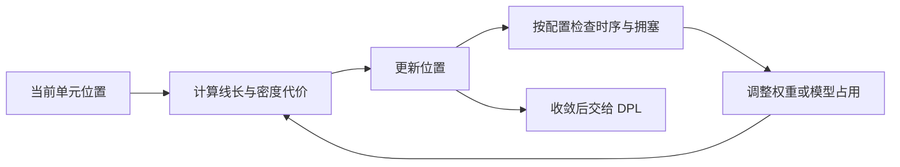

# GPL 模块总览：为大量电路单元安排整体位置

`gpl`（Global Placement，全局布局）在给定版图空间内安排单元的整体分布，尽量让相连的单元靠近、空间利用均衡，并兼顾时序和后续可布线性。其结果为详细布局和布线提供基础。

本文依据 OpenROAD 提交 `a5a08e8356` 的文档与源码编写。配置说明见 [GPL README](../README.md)。

## 1. 为什么布局会影响芯片性能？

网表告诉工具“哪些引脚需要相连”，却不直接决定电路单元的位置。若频繁通信的单元相距很远，连线通常更长，电阻、电容和传播延迟也可能更大；若所有相关单元都挤在一起，又会没有足够空间容纳单元或导线。

因此，GPL 要同时解决两种相反的倾向：**连接关系希望单元靠近，空间容量要求单元适当分散。** 对时序紧张的设计，还要优先照顾关键路径；对拥塞严重的设计，需要为导线留出更好的通道。

标准单元是实现逻辑的小型电路块，宏块是存储器等较大的预设计模块。常见流程先安排宏块，再布局标准单元；GPL 也具有混合尺寸布局能力，实际哪些对象可以移动取决于流程及实例状态。

## 2. 输入和输出

| 输入 | 提供什么 |
| --- | --- |
| OpenDB 中的网表及单元尺寸 | 知道谁与谁相连，每个单元占多少面积。 |
| Floorplan、放置行与固定对象 | Floorplan 即平面规划，确定场地范围、宏块位置和障碍。 |
| I/O 引脚位置及可用区域 | 决定外部连接的吸引方向和内部空间限制。 |
| 密度目标及优化配置 | 控制空间分布，以及是否启用时序或可布线性反馈。 |
| 启用时序驱动时的库、SDC 与 RC 模型 | 判断哪些连接更关键；SDC 是时钟、路径等时序约束。 |

主要输出是**可移动实例的新位置**，以及线长、密度、收敛和相关优化统计。时序驱动模式与 `rsz` 协作时，是否保留单元调整取决于配置，不能一概认为 GPL 只改变坐标。

全局布局结果还要交给 `dpl` 对齐合法站点并消除残留冲突；它也没有生成最终金属连线。

## 3. 核心方法：用连续优化寻找好分布

当前 GPL 基于 RePlAce 的分析式布局思想。可以把它的主要优化目标理解为：

> 连接太长的代价 + 局部过密的代价，并根据需要加入时序和可布线性反馈。

这是概念表达，不是完整源码公式。

**线长项把相关单元拉近。** 常见线长指标 HPWL，是包住一条网络全部端点的最小矩形的宽加高，即半周长。它计算快，适合早期估计，但没有描述绕障、布线层和实际分支路径。求解器还使用适于连续优化的平滑线长模型。

**密度项把过度聚集的单元推开。** 空间被划分成许多小区域，称为 bin。静电类比把单元看作相互排斥的电荷，利用密度场缓解拥挤。Nesterov 方法则是一种加速迭代的数值优化方法，反复更新位置。

**时序驱动反馈提高关键连接的优先级。** 通过时序估计找出裕量较差的网络，提高其权重，并在配置允许时结合单元调整。早期时序依赖估计寄生参数，所以关键性还会随着真实布线而变化。

**可布线性反馈为导线腾出空间。** RUDY 根据连接端点分布估计布线需求，较为快速；也可使用 GRT 获得更具体的拥塞估计。对拥塞区域，算法可以增大单元在优化模型中的占用面积，使其向外疏散。这种“膨胀”本身不等于把真实库单元换成更大的型号。

## 4. 典型场景与结果判断

典型场景是宏块和接口已有一版位置，需要布局大量标准单元。另一个场景是发现布线拥塞后，回到布局阶段改善分布，而不是让详细布线在狭窄区域反复尝试。

例如，大量数据连接必须穿过两块存储器之间的缝隙。只追求短线长，会把相关单元继续拉向缝隙；可布线性优化则可能接受更长一点的线，换取更分散的布线需求。如果通道本身容量不足，还需要调整宏块或 floorplan。

| 指标 | 如何理解 |
| --- | --- |
| HPWL | 越小通常越有利，但只是总线长的代理指标。 |
| 密度 overflow | 反映放置模型中的局部超容；不要与全局布线的轨道容量 overflow 混淆。 |
| 时序裕量 | 反映当前约束和寄生模型下的时序质量。 |
| 拥塞估计 | 指示导线需求集中的区域，需要与后续真实布线验证相结合。 |

低 HPWL、低密度 overflow 都不能单独保证详细布线成功。布局好坏最终应结合合法化位移、布线完成度、时序和面积来判断。

## 5. 与其他模块如何协作？

`ifp`、宏布局和引脚放置提供基本场地与端点；`sta` / `dbSta` 和 `rsz` 提供时序分析及优化反馈；`grt` 可参与拥塞估计；`dpl` 负责合法落位。后续 `cts` 新增时钟单元，`grt` / `drt` 完成布线，都会进一步影响结果。

因此，GPL 是决定后续实现难度的重要阶段，也处在可反复迭代的流程之中。

## 6. 三类角色的后续学习路径

- **OpenROAD 工具使用者：** 从 [测试目录](../test) 选择小设计，先理解普通布局的密度和 HPWL，再比较时序驱动、可布线性驱动的结果。每次只改变一个目标，跟踪到 DPL 和布线后，观察早期指标是否兑现。
- **OpenROAD 其他模块开发者：** 阅读 [replace.cpp](../src/replace.cpp) 与 [placerBase.cpp](../src/placerBase.cpp)，明确可移动对象、固定对象和数据库写回边界。结合 [timingBase.cpp](../src/timingBase.cpp)、[routeBase.cpp](../src/routeBase.cpp) 理解反馈数据的生命周期。
- **GPL 模块开发者：** 按 [initialPlace.cpp](../src/initialPlace.cpp) → [nesterovBase.cpp](../src/nesterovBase.cpp) → [nesterovPlace.cpp](../src/nesterovPlace.cpp) 阅读，补充连续优化、密度场和线长模型知识。修改后同时评估收敛性、确定性、运行时间，以及详细布局和布线后的质量。
