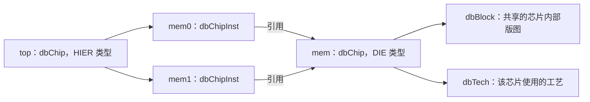

# ODB 3DIC 中文入门

本文基于当前工作区代码（基线提交 `6f17adec9b`）整理，面向刚接触 OpenROAD / ODB 的研发人员。关注“数据如何组织、怎样使用、功能做到哪里”，不逐项罗列 API，也不作为完整的 3DBlox 格式规范。

建议按顺序阅读：

1. 本页：建立数据模型的基本认识。
2. [使用流程与检查](usage.md)：读入设计、查询对象、更新模型和定位问题。
3. [实现边界与源码导航](implementation.md)：确认已实现能力，再按需深入源码。

## 1. ODB 在 3DIC 中负责什么

3DIC 可以理解为：将多颗裸片（die / chiplet）按照位置、方向和高度组合起来，再通过键合接口连接信号。

ODB 保存这套设计的数据，包括芯片层次、三维位置、键合区域、bump（连接凸点）、跨芯片网络和寄生参数。单颗芯片内部的单元、连线、端口仍使用已有的二维对象。

| 设计问题 | 主要对象 |
| --- | --- |
| 一颗芯片内部有哪些单元和连线？ | `dbBlock`、`dbInst`、`dbNet`、`dbBTerm` |
| 系统由哪些芯片组成，各放在哪里？ | `dbChip`、`dbChipInst` |
| 哪些表面区域键合在一起？ | `dbChipRegion`、`dbChipConn` |
| 哪些凸点属于同一条跨芯片信号？ | `dbChipBump`、`dbChipNet` |
| 跨芯片连线的电阻、电容是多少？ | `dbChipRSeg`、`dbChipCapNode` |

ODB 提供数据基础；提取寄生参数、时序分析等算法由相应模块使用这些数据完成。

## 2. 先分清“定义”和“实例”

假设一个系统放置两颗相同的内存芯片：



**`dbChip` 是芯片的定义，`dbChipInst` 是这个定义的一次放置。** 两个实例共享内部版图，但位置和方向可以不同。修改 `mem` 的版图，会影响引用它的所有实例。

`dbChip` 的主要类型：

| 类型 | 用途 |
| --- | --- |
| `DIE` | 普通裸片 |
| `RDL` | 重布线层 |
| `IP` | IP 类型的芯片定义 |
| `SUBSTRATE` | 封装基板 |
| `HIER` | 只负责组合子芯片的层次容器；3DBlox 导入时不为它建立内部版图 |

当前 `dbChipInst::create()` 要求父芯片为 `HIER`。每颗芯片可关联自己的 `dbTech`，因此同一数据库可以组合不同工艺的芯片。

常用入口：`dbDatabase::getChips()` 获取所有芯片定义；`getChip()` 获取选定的顶层芯片；`dbChip::getChipInsts()` 获取该定义直接包含的实例。**定义数量不等于实际放置数量。**

## 3. Region 和 bump：把芯片内部接到系统上

`dbChipRegion` 表示芯片上的一个接口区域，保存矩形范围和所属侧面；`dbChipBump` 表示区域中的一个凸点。

| Region 的侧面 | 含义 |
| --- | --- |
| `FRONT` | 芯片正面 |
| `BACK` | 芯片背面 |
| `INTERNAL` | 芯片内部区域 |
| `INTERNAL_EXT` | 可从外部连接的内部区域，检查器对其有专门规则 |

一个 bump 通过以下对象与二维版图衔接：

```text
dbChipBump
  ├─ getInst()  → dbInst：bump 单元的实际几何和放置
  ├─ getNet()   → dbNet：芯片内部网络
  └─ getBTerm() → dbBTerm：芯片对外端口
```

创建 `dbChipInst` 时，ODB 会为其 master **当时已有的** region 和 bump 自动创建 `dbChipRegionInst` 和 `dbChipBumpInst`。因此通过 API 建模时，应先准备 region / bump，再创建芯片实例；不要假设后补定义会自动更新已有实例。

`mem0` 和 `mem1` 共享 bump 定义，但各有自己的 bump 实例，才能分别接入不同的系统网络。

## 4. 物理键合与逻辑连接是两件事

| 对象 | 表达什么 | 不代表什么 |
| --- | --- | --- |
| `dbChipConn` | 两个 region 实例的键合关系，以及键合层厚度 | 不会自动建立跨芯片信号网络 |
| `dbChipNet` | 一组 bump 实例属于同一条跨芯片网络 | 不保证它们的几何位置满足键合要求 |

例如，上层芯片的 bump A 与下层芯片的 bump B 应传输同一信号，需要同时具备正确的区域键合关系、实际空间位置和逻辑网络归属。

连接端点还要保存**芯片实例路径**。假设 `cluster` 定义中包含 `mem0`，而顶层放置了两个 cluster，那么 `cluster0/mem0` 和 `cluster1/mem0` 才能唯一确定系统中的两颗内存。仅保存 cluster 定义内部的 `mem0` 对象无法区分它们。

`dbChipConn` 的端点和 `dbChipNet::addBumpInst()` 使用的路径，都从所属父芯片开始，包含通向目标的各级实例。

## 5. 层次模型与展开视图

层次模型共享芯片定义，适合保存和编辑设计。做空间检查时，需要知道每颗实际芯片的全局位置，这时使用展开视图（unfolded model）。

调用 `dbDatabase::constructUnfoldedModel()` 后，ODB 从顶层出发，逐级合成坐标变换，为每次实际出现的非 `HIER` 芯片建立展开对象。

| 展开对象 | 主要用途 |
| --- | --- |
| `dbUnfoldedChipInst` | 获取完整实例路径、全局变换和三维包围盒 |
| `dbUnfoldedChipRegionInst` | 获取全局区域范围、表面 Z 坐标和实际朝向 |
| `dbUnfoldedChipBumpInst` | 用 `getGlobalPosition()` 获取 bump 的全局位置 |
| `dbUnfoldedChipConn` | 获取已解析到具体展开区域的连接 |
| `dbUnfoldedChipNet` | 获取实际参与连接的展开 bump |

这里的“展开”只是在芯片层级消除重复引用的歧义，不会复制或打平每颗芯片内部的整个 `dbBlock`。

坐标处理记住三点：

- `dbChipInst::getLoc()` 是相对父芯片的放置坐标；多级层次下不能直接当成全局位置。
- ODB API 的几何量使用整数 DBU。3DBlox 的微米值由导入器换算；换算比例读取 `dbDatabase::getDbuPerMicron()`。
- `FRONT/BACK` 是芯片自身的侧面；经过 `MZ` 翻转后，全局 `TOP/BOTTOM` 会交换。检查堆叠应使用展开区域的 `getEffectiveSide()`，不要只判断原始侧面名称。

**修改层次、放置或连接后，应重建展开视图再分析。** 重建会清空并重新生成展开对象，之前缓存的展开对象指针不能继续使用。

## 6. 跨芯片 RC 已有数据库支持

当前代码已实现 `dbChipCapNode` 和 `dbChipRSeg`，并有创建、销毁和 `.odb` 读写测试。

```text
芯片 A 的端口 / bump                  芯片 B 的端口 / bump
          │                                    │
   dbChipCapNode ─────── dbChipRSeg ────── dbChipCapNode
      对地电容               电阻               对地电容
```

这些对象关联到 `dbChipNet`。电容节点可关联 `dbChipBumpInst`，再通过 `getBTerm()` 找到芯片端口。

RCX 已有使用这些对象的多芯片提取与 SPEF 输出代码，但有自身适用范围。不要把“ODB 能保存一种芯片类型或网络结构”理解成“下游所有算法都支持它”；具体限制见[实现边界](implementation.md)。
