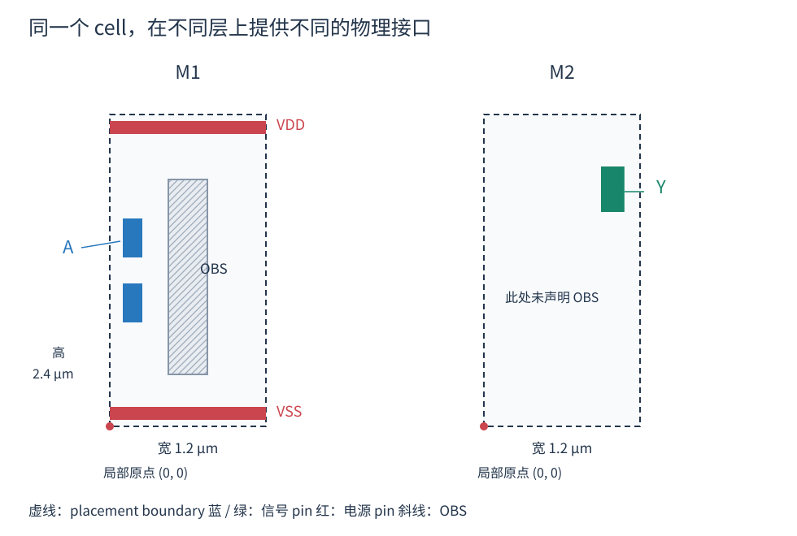
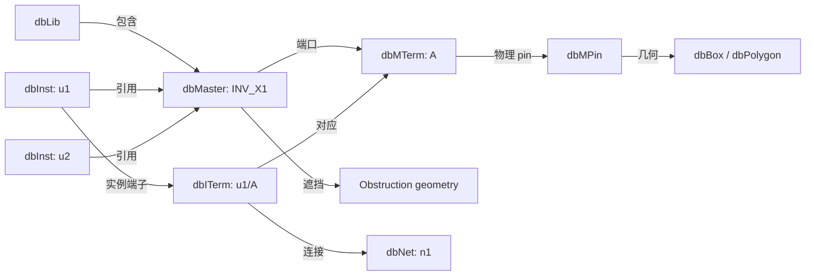
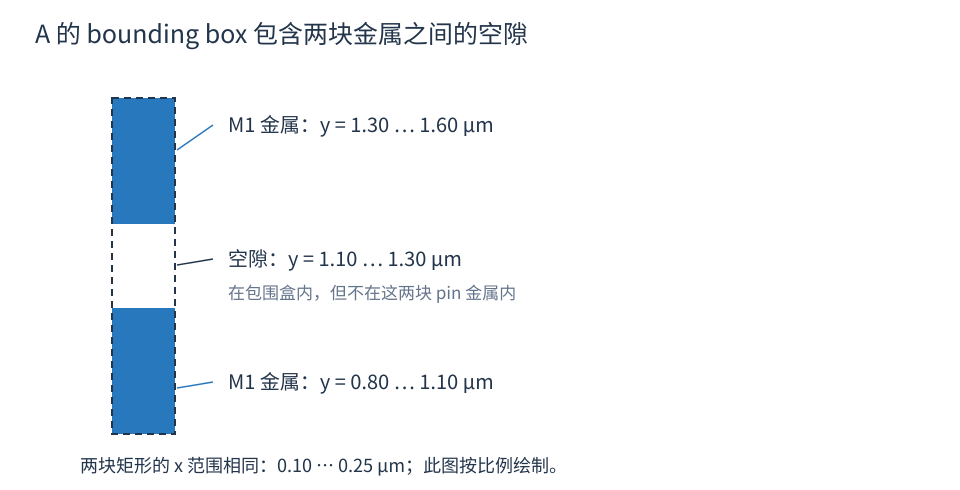
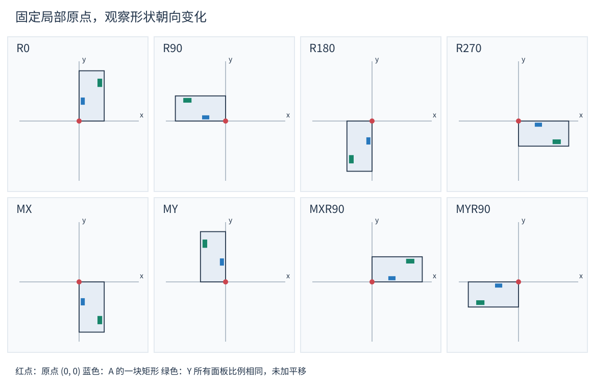
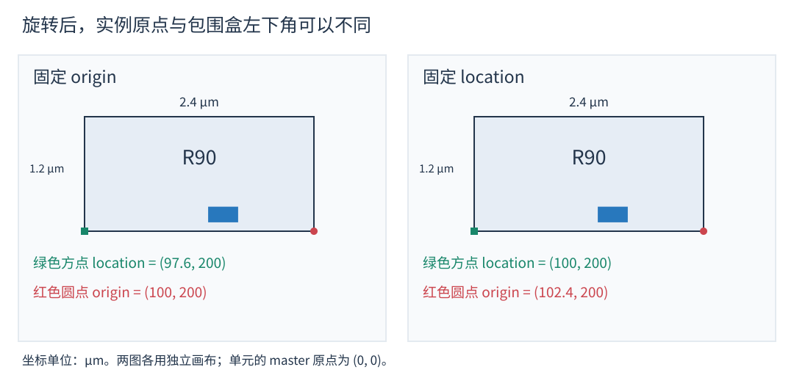

# OpenDB 单元物理视图

单元物理视图（cell physical view）描述一个单元占多大空间、端口在哪里，以及哪些区域会限制布线。OpenDB 以 `dbMaster` 保存可复用的单元物理模板，以 `dbInst` 保存设计中每次使用这个模板的位置、朝向和放置状态，再通过端子对象把物理几何与网络连接起来。

理解这套模型，需要同时看清三件事：**模板中保存什么、实例如何引用模板、局部几何如何映射到设计坐标**。下面使用一个假想的 `INV_X1` 反相器贯穿说明。图中的尺寸和形状均用于教学，不代表任何工艺库，也不用于验证设计规则。

## 1 单元物理视图提供什么

对于布局工具，单元需要给出尺寸、放置边界、site 和 symmetry 等信息。对于布线工具，单元需要给出分层的引脚几何、遮挡以及相关属性。这些信息通常来自 cell LEF。

同一个单元可以有多种互补的数据描述：

| 数据 | 主要内容 | 典型用途 |
| --- | --- | --- |
| Cell LEF | 单元尺寸、引脚几何、遮挡、放置相关属性 | 布局和布线 |
| Liberty | 逻辑功能、时序、电容、功耗模型 | 时序分析、优化 |
| GDS 或 OASIS | 详细版图几何 | 版图交付和物理验证 |

`dbMaster` 的 LEF 物理抽象并不需要包含单元内部的全部晶体管或制造图形。比如，工具可以知道输入端口 A 在 M1 上有一块可连接金属，而不展开它在单元内部怎样连接到晶体管。A 到输出 Y 的延迟则由相应的时序模型描述。



图 1：两个面板表示同一个单元的不同层，虚线边界的位置相同。蓝色和绿色区域是信号引脚，红色是电源或地引脚，灰色斜线区域是布线遮挡。M1 上的遮挡不自动成为 M2 上的遮挡。

## 2 模板对象与实例对象

`dbLib` 包含单元模板，`dbMaster` 描述一种单元。设计中的 `dbInst` 引用一个 master；同一 master 可以被大量实例共享。



图 2：连线表示语义上的包含或引用，不表示每个对象的底层存储表都位于图中的父对象内。

| 信息 | 所在对象 | 示例 |
| --- | --- | --- |
| 单元名字、宽高、原点、类型 | `dbMaster` | `INV_X1`，宽 1.2 μm，高 2.4 μm |
| 放置 site、对称性 | `dbMaster` 引用及属性 | CORE 单元使用的 site、X symmetry |
| 端口名字、方向、信号类型 | `dbMTerm` | A、INPUT、SIGNAL |
| 端口的物理形状分组 | `dbMPin` | A 的一个 PORT 对应的几何集合 |
| 层及形状坐标 | `dbBox`、`dbPolygon` 等 | M1 上的矩形或多边形 |
| 实例位置、朝向、放置状态 | `dbInst` | u1、R90、PLACED |
| 实例端口连接的网络 | `dbITerm` | u1/A 连接 n1 |

`u1/A` 与 `u2/A` 可以连接不同的网络，却共享 A 的模板几何。修改 master 的几何会影响所有引用它的实例；查询实例形状时，应对几何副本应用实例变换。

## 3 端口与物理引脚

### 3.1 dbMTerm 表达端口身份

`dbMTerm` 表达一个 master 上的端口。它保存名字、IO direction 和 signal type 等属性。输入 A、输出 Y、电源 VDD、地 VSS 都通过这类对象描述。

方向与信号类型是两个维度。例如，VDD 可以具有 `INOUT` 方向和 `POWER` 信号类型。知道一个端口的名字和方向，还不足以确定其几何位置，需要继续访问 `getMPins()`。

### 3.2 dbMPin 表达物理形状分组

LEF 导入时的主要对应关系如下：

| LEF 内容 | OpenDB 对象或属性 |
| --- | --- |
| `MACRO` | `dbMaster` |
| `SIZE`、`ORIGIN`、`SITE`、`SYMMETRY` | master 的尺寸、原点、site、对称性 |
| `PIN` | `dbMTerm` |
| 含几何内容的 `PORT` | `dbMPin` |
| `LAYER` 与 `RECT`、`POLYGON` | 带层信息的几何对象 |
| `OBS` | master 的遮挡几何 |

一个 `PIN` 可以包含多个 `PORT`，一个 `PORT` 可以包含多个几何形状。因此，**一个端口不等于一个物理 pin，一个物理 pin 也不等于一个矩形**。当前 reader 会为每个含有几何内容的 PORT 创建 `dbMPin`，见 [LEF reader](../src/lefin/lefin.cpp) 中的 `numPorts()` 循环。

下面是用于说明映射关系的 LEF 片段；省略了完整库所需的工艺层、site 定义及其他端口：

```lef
MACRO INV_X1
  CLASS CORE ;
  ORIGIN 0 0 ;
  SIZE 1.2 BY 2.4 ;
  SYMMETRY X Y ;
  SITE core_site ;
  PIN A
    DIRECTION INPUT ;
    USE SIGNAL ;
    PORT
      LAYER M1 ;
      RECT 0.10 0.80 0.25 1.10 ;
      RECT 0.10 1.30 0.25 1.60 ;
    END
  END A
  OBS
    LAYER M1 ;
    RECT 0.45 0.40 0.75 1.90 ;
  END
END INV_X1
```

这里的两个 RECT 属于同一个 `dbMPin`。矩形集合描述外部可见的接口；仅凭形状之间的空隙，不能反推出单元内部的连接结构。

### 3.3 Bounding box 不等于引脚金属



图 3：两块蓝色矩形都属于 A，虚线表示它们的 bounding box。虚线框内部的白色空隙不属于这两块金属。

`dbMPin::getBBox()` 或 `dbMTerm::getBBox()` 适合快速获取空间范围，但不能替代实际 geometry 来判断接触、重叠或可接入区域。多个层上的形状还可能投影到同一 XY 范围，判断几何关系时必须同时检查层。

`dbMPin::getGeometry()` 可遍历矩形几何；当前 API 也提供 `getPolygonGeometry()`。默认的 `getGeometry()` 包含分解后的多边形矩形，若再遍历原始 polygon，要明确是否会重复处理同一形状。`dbBox` 还可表示 via，不能把所有 `dbBox` 都直接当成单层矩形。

### 3.4 引脚区域与接入点

引脚几何提供导电区域，布线器再结合轨道、线宽、间距、via enclosure 和邻近障碍选择接入方式。ODB 的 `dbMPin` 提供 pin access 数据接口，但创建或导入 pin geometry 并不意味着已经生成可用的接入点。

实例朝向和周围环境会影响接入条件。因此，pin 有几何形状，也可能难以接入；端口的几何中心也不必然是合法接入点。

## 4 放置边界与布线遮挡

**Placement boundary 描述放置占地，obstruction 描述分层的布线限制。** 两者分别服务于放置和布线，不能相互替代。

在当前实现中，master 宽高为 `W`、`H`，`getOrigin()` 为 `(mx, my)` 时，`getPlacementBoundary()` 返回：

```text
[-mx, -my] — [W - mx, H - my]
```

当 master 原点为零时，它就是 `[0, 0] — [W, H]`。非零原点时，应使用 API 返回的边界，而不自行假设左下角是 `(0, 0)`。对应实现见 [dbMaster.cpp](../src/db/dbMaster.cpp) 的 `getPlacementBoundary()`。

Master 的遮挡通过 `getObstructions()`、`getPolygonObstructions()` 访问。它们是 master 的几何，通常由 LEF `OBS` 导入；不要与 block 级的 `dbObstruction` 对象混淆。

M1 上的 OBS 会约束相应层上的布线。单元占据某个矩形，并不表示该矩形上方所有金属层都被禁止使用。布线器还要结合间距等规则处理遮挡，不能仅用中心线是否穿过 OBS 判断合法性。

## 5 从单元坐标到设计坐标

### 5.1 数据库单位

图和 LEF 示例使用 μm 便于阅读；ODB 几何使用整数数据库单位 DBU。若每微米为 `U` 个 DBU，则：

```text
坐标值 DBU = 坐标值 μm × U
```

例如 `U = 1000` 时，`0.10 μm` 为 `100 DBU`。不要固定假设每个 DBU 都是 1 nm，应读取相应对象的 `getDbUnitsPerMicron()`，并在输入转换时处理舍入与网格约束。

### 5.2 先改变朝向 再平移

对 master 局部点 `p`，其在实例所在 block 中的位置为：

```text
p_block = R_orient × p_master + O_inst
```

其中 `R_orient` 是旋转或镜像，`O_inst` 是 `dbInst::getOrigin()`。朝向操作围绕局部坐标原点进行。`dbInst::getTransform()` 直接封装这两个量。

下面的图将同一个单元分别应用 8 种朝向，所有面板均暂不平移。红点是固定的局部原点，蓝色 A 和绿色 Y 标记帮助辨认几何怎样变化。



图 4：旋转、镜像可能把几何移到负坐标区。这里的 R90、R270 都按逆时针定义；MX、MY 分别表示关于 X、Y 轴镜像。

| 朝向 | 局部点 `(x, y)` 的结果 | 操作 |
| --- | --- | --- |
| R0 | `(x, y)` | 不旋转 |
| R90 | `(-y, x)` | 逆时针旋转 90° |
| R180 | `(-x, -y)` | 旋转 180° |
| R270 | `(y, -x)` | 逆时针旋转 270° |
| MX | `(x, -y)` | 关于 X 轴镜像 |
| MY | `(-x, y)` | 关于 Y 轴镜像 |
| MXR90 | `(y, x)` | 先 MX，再 R90 |
| MYR90 | `(-y, -x)` | 先 MY，再 R90 |

这些二维变换改变 XY 坐标，不改变 pin 所属的金属层；也不会更改端口身份或实例连接的 net。实现见 [dbTransform.cpp](../src/db/dbTransform.cpp) 的 `apply(Point&)`。

### 5.3 引脚矩形的计算示例

令 A 的第一块矩形为 `(0.10, 0.80) — (0.25, 1.10)`，实例原点为 `(100, 200)`，单位均为 μm。

| 朝向 | 变换后的矩形左下角 | 变换后的矩形右上角 |
| --- | --- | --- |
| R0 | `(100.10, 200.80)` | `(100.25, 201.10)` |
| R90 | `(98.90, 200.10)` | `(99.20, 200.25)` |
| MX | `(100.10, 198.90)` | `(100.25, 199.20)` |

以 R90 为例，原始两个对角点分别变为 `(99.20, 200.10)` 和 `(98.90, 200.25)`。分别取 X、Y 的最小值和最大值后，得到表中的新矩形。

这 8 种朝向都保持矩形轴对齐，因此 ODB 可变换两个对角点并重新规范化矩形。该方法不能直接推广到任意角度旋转后的精确形状。

### 5.4 Origin 与 location

实例的 `getOrigin()` 表示局部原点在 block 中的位置，`getLocation()` 表示实例包围盒的左下角。旋转或镜像后，两者经常不同。



图 5：单元宽 1.2 μm、高 2.4 μm，master 原点为零。左图保持实例原点 `(100, 200)`，R90 后包围盒左下角变为 `(97.6, 200)`；右图要求左下角仍为 `(100, 200)`，因此实例原点必须是 `(102.4, 200)`。

对于任意 master 原点，设旋转或镜像后的 placement boundary 左下角是 `b_min`，则：

```text
location = instance_origin + b_min
instance_origin = desired_location - b_min
```

当前 `setLocation()` 正是用变换后的 placement boundary 计算原点。需要保持左下角改变朝向时，可以使用 `setLocationOrient()`；如果分别设置，则先确定朝向，再设置 location。计算引脚坐标时，优先直接使用 `getTransform()`，避免把 location 错当成变换平移量。

这里的设计坐标指实例所在 block 的坐标。跨物理层次需要继续复合父级变换，可查看 `getHierTransform()`。

## 6 能表达与能合法放置的区别

数据库支持某种几何变换，并不保证该朝向适合具体的单元和 row。工具还需要检查 site、symmetry、行结构、电源轨对齐及其他约束。例如，R90 在数学上没有问题，但宽高互换后，标准单元未必还能匹配原来的行。

`dbMaster` 的 symmetry 表示模板的对称性属性，`dbInst::getOrient()` 表示某次使用选择的实际朝向。两者应分别理解。移动或旋转实例也不等于完成合法化。

VDD、VSS 是物理接口的一部分，它们的端口类型、几何位置及实例连接都需要正确。单元靠近电源轨，不等于数据库中已经建立了正确连接；网络关系与实际导体连接需要分别检查。

## 7 用 C++ 查询实例中的引脚矩形

以下函数展示从实例端子遍历 master pin geometry，再应用实例变换的路径。代码读取现有数据库，输出单位为 DBU，坐标系为实例所在 block。

```cpp
#include <vector>

#include "odb/db.h"
#include "odb/dbTransform.h"

struct PinRect
{
  odb::dbTechLayer* layer;
  odb::Rect rect;
};

std::vector<PinRect> getPinRects(odb::dbITerm* iterm)
{
  std::vector<PinRect> result;
  const odb::dbTransform transform = iterm->getInst()->getTransform();

  for (odb::dbMPin* mpin : iterm->getMTerm()->getMPins()) {
    for (odb::dbBox* box : mpin->getGeometry()) {
      // 本例只提取层上的矩形；via 需要另行展开各层形状。
      if (box->isVia()) {
        continue;
      }
      odb::Rect rect = box->getBox();
      transform.apply(rect);
      result.push_back({box->getTechLayer(), rect});
    }
  }
  return result;
}
```

`getGeometry()` 默认包含多边形分解后的矩形；如果需要原始轮廓，可使用 `getPolygonGeometry()`，对 polygon 副本应用同一变换。via 可通过相应展开接口取得各层形状后再变换。这个查询提供几何，不判断 DRC 或接入合法性。

不要为旋转单个实例调用 `dbMaster::transform()`：它会修改共享的 master 引脚和遮挡。这里对 `Rect` 副本调用 `transform.apply()`，保留了模板共享关系。

## 8 源码阅读入口

| 要理解的内容 | 文件与主要接口 |
| --- | --- |
| 公开对象模型 | [db.h](../include/odb/db.h)：`dbMaster`、`dbMTerm`、`dbMPin`、`dbInst`、`dbITerm` |
| 模板边界和遮挡 | [dbMaster.cpp](../src/db/dbMaster.cpp)：`getPlacementBoundary()`、`getObstructions()` |
| 端口与物理 pin | [dbMTerm.cpp](../src/db/dbMTerm.cpp)、[dbMPin.cpp](../src/db/dbMPin.cpp) |
| 实例位置和朝向 | [dbInst.cpp](../src/db/dbInst.cpp)：`setLocation()`、`setLocationOrient()`、`getTransform()` |
| 几何变换 | [dbTransform.cpp](../src/db/dbTransform.cpp)：`apply()` |
| LEF 到对象的映射 | [lefin.cpp](../src/lefin/lefin.cpp)：macro 属性、pin PORT 和 geometry 导入 |

几何图的 SVG 保存在 `images/cell_physical_view/`，可以直接用浏览器打开。运行 `python3 src/odb/doc/generate_cell_physical_view_figures.py` 可用 Python 标准库重新生成这些图。
