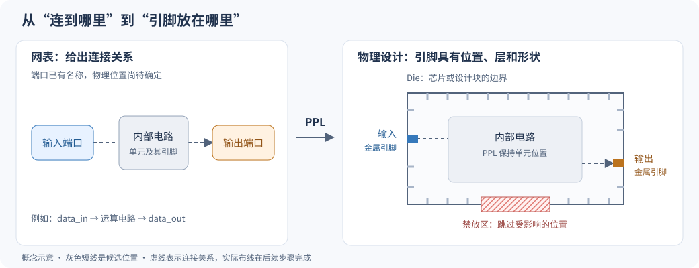

# PPL 模块总览：为设计安排对外连接的位置

`ppl`（Pin Placer，引脚放置器）负责把设计的对外端口落实为**有位置、有金属层、有形状的物理引脚**。它结合端口与内部电路的连接关系，在可用位置中安排引脚，满足放置约束，并尽量降低连接线长的估算值。

本文面向首次接触芯片物理设计的读者，依据本仓库提交 `a5a08e8356` 的文档与源码编写。前五节介绍核心概念和应用，最后一节为 OpenROAD 使用者、其他模块开发者和 `ppl` 开发者分别提供学习路线。完整命令参数见 [PPL README](../README.md)。

## 1. 为什么需要引脚放置？

设计最初可以用一份“连接清单”描述：有哪些电路单元、哪些端口与哪些单元相连。这份清单叫作**网表**。例如，端口 `data_in` 连到一组运算单元，运算结果再通过 `data_out` 输出。网表说明了信号如何连接，却未必规定这些端口在芯片上的实际位置。

到了物理设计阶段，端口必须有可供金属导线接入的实体。可以把设计块想成一栋建筑：内部房间是电路单元，端口是出入口，导线是通道。即使房间和通道的连接关系已经确定，出入口开在哪里仍然会影响通行距离和空间使用。

如果与左侧电路相连的引脚被放到右侧，连线可能横跨整个设计；如果大量引脚挤在一小段边界，后续布线可能拥堵；如果引脚占用了电源金属或其他障碍物的位置，则会产生几何冲突。因此，引脚放置需要同时回答两个问题：**哪里可以放，以及放在哪里更合适。**



图中蓝色、橙色矩形表示端口的物理引脚，灰色短线表示候选位置，红色区域表示禁放区。虚线只表示连接关系；实际导线由后续布线步骤生成。图为概念示意，尺寸和间距不按比例。

先认识几个会反复出现的词：

| 概念 | 本文中的含义 |
| --- | --- |
| 端口（port） | 当前设计对外暴露的逻辑连接点，例如输入、输出和双向端口。 |
| 物理引脚（pin） | 端口在版图上的金属接触形状，具有坐标、尺寸和金属层。 |
| 网络（net） | 电气上相连的一组端点；一个端口可以连接多个内部单元引脚。 |
| Die 边界 | 当前设计的外轮廓；独立实现一个设计块时，它也可以表示该块的边界。 |
| Core 区域 | 主要用于放置内部电路单元的区域，通常位于 die 内部。 |
| 金属层与轨道（track） | 芯片用多层金属连线；轨道是各层可供布线参考的离散位置。 |

这里的 pin 通常是一小块金属，并不是封装外面看得见的金属针脚。`ppl` 的常规放置依据是 **die 边界**；不要把它与内部 core 的边界混为一谈。

## 2. PPL 在 OpenROAD 流程中的位置

把与 `ppl` 直接相关的流程简化后，可以写成：

```text
网表 + 工艺/单元物理信息
            ↓
建立 floorplan：确定设计边界，准备布线轨道
            ↓
PPL：安排端口的物理引脚
            ↓
后续单元布局、优化与布线使用这些引脚位置
```

这条顺序适合说明初次放置。实际流程也可以先获得一版内部单元布局，再运行 `ppl`，使它利用更准确的连接端点位置；需要时还可以在布局与引脚放置之间迭代。因此，`ppl` 不要求所有内部单元都已放好，但**运行时拥有怎样的位置数据，会直接影响优化依据**。

相邻模块的分工可以这样理解：

| 模块 | 主要决定什么 | 与 PPL 的关系 |
| --- | --- | --- |
| `ifp`：初始平面规划 | 设计边界、单元放置行等基础几何信息 | 为 PPL 提供场地；布线轨道也需要事先准备。 |
| `gpl` / `dpl`：单元布局 | 内部单元放在哪里，以及位置是否合法 | 单元位置影响 PPL 的线长估算；端口位置也影响单元布局。 |
| `pdn`：电源网络 | 电源、地的金属网络 | 已存在的相关金属形状会限制引脚可用位置。 |
| `grt` / `drt`：全局、详细布线 | 导线经过哪些区域，最终如何落到轨道上 | 使用引脚的层和形状完成连接，并进一步检查可布通性。 |
| `pad`：芯片级连接 | I/O 环、pad 单元、bump 阵列等 | 承担芯片级接口结构的构建；PPL 的重点是端口金属形状的位置分配。 |

PPL 放置时保持内部单元位置和逻辑连接关系，更新端口的物理实现。模块职责可对照 [IFP 文档](../../ifp/README.md)、[全局布线文档](../../grt/README.md) 和 [芯片级连接文档](../../pad/README.md)。

## 3. 输入是什么，输出是什么？

PPL 直接处理的是 **OpenDB 中已经加载好的设计**。OpenDB 是 OpenROAD 各模块共享的设计数据库。LEF、DEF、Verilog 等文件是准备数据库的常见来源，不是每次运行 PPL 都要重新传入的一组专用文件。

| 输入 | 提供的信息 | 为什么需要 |
| --- | --- | --- |
| 当前设计与网表连接 | 对外端口、相关网络、网络上的内部单元引脚 | 知道要放哪些引脚，以及它们连接到哪里。 |
| Die 轮廓与布线轨道 | 边界形状、所选层上的轨道位置 | 生成可以考虑的放置位置。 |
| 工艺信息 | 金属层方向、宽度、最小面积、间距和制造网格等 | 决定引脚的层、形状及相关几何限制。 |
| 内部单元的位置状态 | 已布局单元的引脚坐标，哪些单元尚未布局 | 估算不同引脚位置的连接代价。 |
| 既有物理对象 | 固定引脚、已放置宏块、布线障碍物、电源网络等 | 排除受影响的候选位置。 |
| 用户意图 | 允许的边或区域、分组、顺序、镜像关系、间距等 | 使结果符合接口规划要求。 |

**最重要的输出是数据库里更新后的物理引脚。** 每个参与放置的端口得到相应的坐标、金属层、矩形金属形状和放置状态。对自动放置而言，状态通常是 `PLACED`。运行后可以通过 OpenROAD 的数据库或 DEF 导出功能保存结果，也可以把引脚位置导出为一组可重放的 `place_pin` 命令。后者保存的是引脚放置脚本，不是完整设计。

日志还会报告可用位置、放置情况及 I/O 相关线长估算。成功完成引脚放置，说明这一阶段完成了分配和相关检查；最终连线、时序和完整设计规则检查仍由后续流程验证。

上述输入读取和结果写回可在 [IOPlacer.cpp](../src/IOPlacer.cpp) 的 `initCore()`、`initNetlist()`、`commitIOPinToDB()` 中对应起来。

## 4. PPL 怎样决定引脚位置？

### 4.1 先找出可以放的位置

PPL 把连续的边界转化成一批离散的候选位置，源码称为 **slot**。每个 slot 除了坐标，还关联金属层及所在的边。

在常规矩形设计中，水平布线轨道用于左右边上的引脚，垂直轨道用于上下边上的引脚。沿轨道生成候选位置后，还要考虑引脚最小距离、角落避让、用户禁放区、固定引脚及障碍物的影响。同一个平面坐标在不同金属层上也可能对应不同的候选位置。

这解释了为什么“边界看起来很长”不一定代表“引脚放得下”：实际容量由**允许的层、轨道、间距、障碍物和区域限制共同决定**。例如，一个区域筛选后只剩 8 个可用位置，就无法容纳 12 个独立引脚；即使总位置数足够，也未必能容纳一组要求连续放置的引脚。

### 4.2 把接口要求变成约束

常见约束表达的是设计意图，不要求用户预先指定每个坐标：

| 意图 | 约束如何表达 |
| --- | --- |
| 某组输入从左侧进入 | 把这些端口限制在左边，或左边的一段区间。 |
| 为其他结构留出空间 | 将相应边界区间设为禁放区。 |
| 一组总线信号靠在一起 | 将端口编为一组；需要明确位序时再指定顺序。 |
| 两侧接口需要对齐 | 设置成对的镜像引脚，使其在相对边上对称放置。 |
| 少数接口坐标已确定 | 先固定这些引脚，再自动安排剩余引脚。 |

“分组”和“有序”是不同要求：一组信号靠在一起，并不自动意味着按总线位号排列。镜像关系则要求成对的位置互相配合，不能把两个引脚各自放到独立的最优位置。

### 4.3 用线长估算比较候选位置

PPL 的核心代价是 **HPWL（Half-Perimeter Wirelength，半周长线长）**。把一个待放置的 I/O 引脚位置及其网络上的内部单元引脚位置，用一个最小矩形包住，这个矩形的宽加高就是对应的估算值：

```text
HPWL = (最大 x − 最小 x) + (最大 y − 最小 y)
```

例如，假设一个端口仅连接到内部坐标 `(20, 50)`，两个候选位置分别在左边 `(0, 50)` 和右边 `(100, 50)`，坐标单位均为微米：

| 候选位置 | HPWL | 在没有其他约束时的含义 |
| --- | --- | --- |
| 左边 `(0, 50)` | `20 + 0 = 20 µm` | 连接更近，代价更低。 |
| 右边 `(100, 50)` | `80 + 0 = 80 µm` | 需要跨越更长距离。 |

如果左边被禁止使用，工具仍需在其他可行位置中选择。多个引脚同时争用位置时，也要考虑整体代价，不能让每个引脚都占据自己最喜欢的同一个 slot。

HPWL 的优点是计算快，适合比较大量方案。它没有画出真实导线路径，也没有直接衡量绕障碍物、过孔、拥塞和时序代价。因此，**HPWL 更低表示这个近似指标更好，不等于最终布线或时序一定更好。** 这里估算的是参与放置的 I/O 端口与其内部连接的代价，不是全芯片所有网络的总布线长度。

还有一个关键前提：**若相连的内部单元尚未布局，PPL 会用 die 外包矩形的中心替代该单元的引脚位置。** 这样早期流程仍然可以放置引脚，但代价无法体现这些单元今后实际分布在哪一侧。已有可信单元布局时，基于位置的优化才有更充分的信息。

计算方法见 [Netlist.cpp](../src/Netlist.cpp) 的 `computeIONetHPWL()`；未布局单元的位置处理见 [IOPlacer.cpp](../src/IOPlacer.cpp) 的 `initNetlist()`。

### 4.4 分配引脚，再生成金属形状

当前实现提供两条主要求解路径：

| 路径 | 可以怎样理解 | 适合关注什么 |
| --- | --- | --- |
| 默认的分段匹配 | 先把候选位置划成若干段，将引脚或引脚组安排到段，再用匈牙利匹配算法求解段内的分配。 | 理解引脚与位置的配对，是入门时优先学习的路径。 |
| 可选的模拟退火 | 从初始分配出发，反复移动或交换引脚、调整引脚组；早期可以按概率接受暂时变差的方案，随后逐步降低这种概率。 | 探索边界引脚的另一种分配方案，并比较结果与运行成本。 |

匈牙利算法解决的是给定代价表上的匹配问题；PPL 还有分段、分组、镜像和特殊情况处理，因此不能由算法名称推断整个引脚放置取得了全局最优。模拟退火同样是一种搜索方法，结果需要实际比较。

分配完成后，工具确定引脚朝向和矩形形状。常规边界引脚默认按所用层的最小宽度、最小面积等信息计算尺寸，也允许用户设置尺寸相关参数。随后进行重复位置、区域约束、镜像关系等检查，并把结果写回数据库。这一步把“占用某个候选位置”落实为后续布线可以连接的金属实体。

两条路径分别见 [HungarianMatching.cpp](../src/HungarianMatching.cpp) 和 [SimulatedAnnealing.cpp](../src/SimulatedAnnealing.cpp)，整体调度见 [IOPlacer.cpp](../src/IOPlacer.cpp)。

## 5. 典型使用场景

### 常规设计块的边界引脚

这是最直接的场景：已有设计边界、网表和轨道，需要为一批端口安排位置。既可以在布局早期生成初始接口，也可以在内部单元已有位置后，利用连接距离调整接口。基础示例见 [gcd.tcl](../test/gcd.tcl)，未布局单元的例子见 [cells_not_placed.tcl](../test/cells_not_placed.tcl)。

为了认识操作顺序，下面只展示 PPL 相关的流程片段；假设设计、工艺信息和轨道均已加载，并采用仓库 Nangate45 示例中的层名：

```tcl
# 将输入接口限制在上边，其余端口由工具安排。
set_io_pin_constraint -direction INPUT -region top:*

# metal3 为水平层，metal2 为垂直层；其他工艺应使用自己的层名。
place_pins -hor_layers metal3 -ver_layers metal2

# 保存包含物理引脚的设计，以及便于重放的引脚放置脚本。
write_def /tmp/ppl-overview.def
write_pin_placement /tmp/ppl-overview-pins.tcl
```

理解“准备数据库 → 表达约束 → 执行放置 → 保存并查看结果”即可，无需先记住全部参数。

### 按系统接口规划端口

当一个设计块的左侧连接上游、右侧连接下游时，可以用边或区间约束表达接口朝向。总线可进一步分组并排序，双侧接口可以指定镜像关系；已有电源结构、宏块或预留通道则影响可用空间。

相关例子包括 [区域约束](../test/add_constraint1.tcl)、[引脚分组](../test/group_pins1.tcl)、[镜像引脚](../test/annealing_mirrored1.tcl) 和 [避让边界电源金属](../test/pdn_boundary_stripes.tcl)。此时评估结果要同时关注接口要求是否满足、可用空间是否充足，以及后续布线表现。

### 在芯片表面安排二维引脚网格

一些面对面连接的三维集成场景，需要在芯片表面分布大量连接点。PPL 可以在指定金属层上定义二维放置网格，将选定端口限制到网格中的区域，适用于微凸点或混合键合等接口的引脚位置规划。这里的能力是生成和安排端口金属形状，完整封装和键合结构还需相应流程完成。

这类场景先定义网格的层、范围、横纵步长和引脚尺寸，再把端口约束到该网格。命令中的 `up` 指表面网格，`top` 指平面图中的上边，两者含义不同。可从默认匹配路径的 [top_layer1.tcl](../test/top_layer1.tcl) 学起。当前退火入口使用边界候选位置，表面网格场景应沿默认匹配路径学习和使用。

此外，当前模块支持正交多边形 die，即由水平、垂直线段组成的非矩形轮廓。引脚可以沿这种轮廓的边放置，相关说明见 [README 的非矩形平面规划部分](../README.md#rectilinear-floorplans)。

## 6. 不同读者下一步学什么？

### 6.1 OpenROAD 工具使用者：先建立可解释的实验

目标是能准备输入、表达接口意图，并解释放置结果为什么如此。

1. 从 [gcd.tcl](../test/gcd.tcl) 和 [PPL README](../README.md) 开始，认识层、边界、轨道及引脚形状。在 GUI 中找到放置后的端口，核对位置和层。
2. 每次只改变一种约束，例如先把输入限制到上边，再尝试分组或禁放区。观察引脚分布和可用位置如何变化，比一次设置所有参数更容易建立直觉。
3. 对比未布局与已布局单元的输入，理解位置数据对 HPWL 的影响。观察线长估算时，同时查看后续拥塞、可布通性和时序结果。
4. 需要固定少数端口时，学习 `place_pin` 与 `FIXED` 状态，再安排其余引脚；需要复用结果时，学习数据库、DEF 与引脚脚本三种保存方式。

遇到“没有足够位置”时，优先检查所选层及轨道、区域大小、间距和阻挡情况。若候选位置本身不足，调整搜索参数不能增加物理容量。

### 6.2 OpenROAD 其他模块开发者：掌握数据库交接关系

目标是明确 PPL 读取哪些状态、改写哪些对象，以及自己的模块如何正确消费结果。

先看 [公共接口 IOPlacer.h](../include/ppl/IOPlacer.h)，再读 [IOPlacer.cpp](../src/IOPlacer.cpp) 中的 `initCore()`、`initNetlist()` 和 `commitIOPinToDB()`。需要建立以下对象对应关系：

| OpenDB 对象 | 与 PPL 的关系 |
| --- | --- |
| `dbBlock` | 当前设计，提供 die、轨道、实例、端口及相关约束。 |
| `dbBTerm` | 设计的逻辑端口，也是找到物理引脚和关联网络的入口。 |
| `dbBPin` / `dbBox` | 端口的物理引脚及其具体金属矩形。 |
| `dbNet` / `dbITerm` | 网络及内部实例引脚，用来建立连接和估算代价。 |
| `dbTechLayer` | 金属层及相关工艺信息。 |

集成时尤其要理解三点：

- **单位和坐标来源。** 用户脚本中的几何距离通常使用微米，核心代码使用整数数据库单位（DBU）；内部已布局实例的位置与未布局实例的替代位置会影响代价。
- **固定状态与重复运行。** 常规自动放置结果是 `PLACED`，不能据此认为后续调用一定保留原位置；`initNetlist()` 会跳过首个物理引脚状态为固定的端口，并记录其形状作为避让依据。
- **物理对象的生命周期。** 写回会删除参与放置端口的旧 `dbBPin`，重新创建形状。逻辑端口和网络连接保持，但其他模块不应跨这一步继续使用旧物理引脚对象的引用；依赖原有几何的缓存也需要更新。

随后结合自己的模块，判断应在 PPL 前提供哪些信息、在 PPL 后重新读取哪些结果。例如，既有电源金属需要在放置时可见，后续布线则需要消费更新后的引脚形状。

### 6.3 PPL 模块开发者：沿数据流读算法

目标是能说明一个引脚为何成为候选、为何选中某个位置，以及为何得到最终形状。建议按下面的顺序阅读：

| 顺序 | 阅读入口 | 要回答的问题 |
| --- | --- | --- |
| 1 | [Netlist.h](../src/Netlist.h)、[Netlist.cpp](../src/Netlist.cpp) | I/O 引脚与内部端点怎样组织？候选位置怎样变成 HPWL 代价？ |
| 2 | [Core.h](../src/Core.h)、[Slots.h](../src/Slots.h)，以及 `defineSlots()` | 几何与工艺信息怎样形成 slot？哪些位置被排除？section 怎样把问题分段？ |
| 3 | `runHungarianMatching()` 与 [HungarianMatching.cpp](../src/HungarianMatching.cpp) | 约束、分组和镜像怎样影响分配？段内代价表怎样建立？ |
| 4 | `runAnnealing()` 与 [SimulatedAnnealing.cpp](../src/SimulatedAnnealing.cpp) | 初始解、移动、交换和接受准则怎样工作？约束如何影响搜索？ |
| 5 | `updatePinArea()`、`checkPinPlacement()`、`commitIOPinToDB()` | 抽象位置怎样转成金属形状？结果检查和数据库写回各负责什么？ |

表中未单独链接的函数均在 [IOPlacer.cpp](../src/IOPlacer.cpp)。其中内部类 `Core` 封装了放置所需的边界和轨道信息；其边界来自 die，不应仅凭类名推断它表示标准单元 core 区域。需要追踪脚本调用或单位转换时，再补读 [IOPlacer.tcl](../src/IOPlacer.tcl) 和 [IOPlacer.i](../src/IOPlacer.i)。

阅读源码时，配合 [test 目录](../test) 中的基础放置、约束、分组、退火和表面网格用例。`.ok`、`.defok` 是仓库保存的预期日志或结果，本文未重新执行这些回归。若后续修改算法，应同时评估放置合法性、线长估算、运行成本及下游布线影响；新增回归需在 [CMakeLists.txt](../test/CMakeLists.txt) 和 [BUILD](../test/BUILD) 中同时注册，执行方法见 [项目测试指南](../../../docs/agents/testing.md)。
