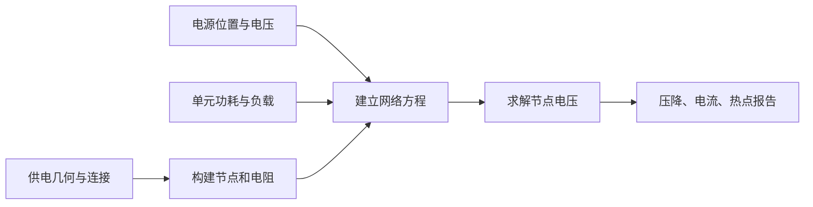

# PSM 模块总览：检查电源网络能否把电压送到用电位置

`psm` 是 OpenROAD 中基于 PDNSim 的静态电源网络分析模块。它把已经生成的供电金属转换为电阻网络，在指定电源和负载条件下计算电压分布、IR drop，并帮助检查悬空连接和电流集中问题。

本文依据 OpenROAD 提交 `a5a08e8356` 的文档与源码编写。分析设置见 [PSM README](../README.md)。

## 1. 为什么“电源已接通”还不够？

导线有电阻。当单元从电源网络吸取电流时，沿途会损失一部分电压。一个简单电阻上的压降可写成：

> 电压降 = 电流 × 电阻，即 ΔV = I × R。

芯片上的网络具有许多并行通路，不能只拿一段导线套这个公式，需要求解整个网络。距离电源入口较远、负载集中或通路较窄的位置，可能出现较大压降，从而影响电路工作速度和供电裕量。

地网络同样有电阻，电流流回参考地时可能使局部地电位升高。电路真正得到的有效供电取决于当地电源与地之间的电位差，因此只看电源网或只看地网都不足以描述全部情况。

## 2. 输入和输出

| 输入 | 用途 |
| --- | --- |
| OpenDB 中的供电金属、过孔和引脚连接 | 建立电阻网络及负载接入点。 |
| 单元位置和功耗负载 | 决定哪里吸取多少电流；功耗可来自 STA 估计，也可由用户覆盖。 |
| 供电电压和电源位置 | 确定网络的电源边界，例如 bump、pad 或抽象供电源。 |
| 金属、过孔的电阻信息及分析角 | 确定网络电阻与所用工作条件。 |
| 电源模型设置 | 区分供电入口的分布，并可考虑外部等效电阻等因素。 |

输出包括**节点或实例电压、最差压降、分段电流及相关报告、连通性诊断和热图**。模块也支持导出供电网络的 SPICE 表示，供进一步分析使用。

其中“热图”表示数值大小的颜色分布，这里通常是电压降，而不是温度图。

## 3. 核心工作：从金属形状到电路方程

**构建电阻网络并检查连接。** 把供电线段、交叉连接、过孔和单元电源端点组织成节点与支路。悬空条带或未接通的供电端点需要先诊断；几何上相邻不一定代表电气连通。

**确定负载电流。** 在静态模型中，可以用功耗和供电电压的关系 `I ≈ P / V` 理解负载电流的来源。实现将相关实例负载分配到接入节点。功耗估计又依赖库、信号活动和分析环境；没有合理负载，求解器再准确也无法给出有意义的压降预测。

**确定电源边界。** 电从哪里进入网络非常重要。同一张网格，从少数入口供电与假定顶层大量节点都是理想电源，结果会明显不同。PSM 提供 FULL、BUMPS、STRAPS 等供电源模型，也支持显式电源位置文件，应选择与设计供电方案相符的模型。

**求解电压和支路电流。** 根据电流守恒建立线性方程组，解出节点电压，再计算压降及各段电流。读者不必先掌握矩阵算法，但需要记住结果依赖网络、电源和负载三方面共同定义的场景。

## 4. 典型场景与分析边界

**验证 PDN 方案。** 某区域压降较大时，检查是否远离电源、条带太疏、过孔不足或负载过于集中，再调整 PDN 或布局。

**发现网格断点。** 宏块周围某条电源线看似相连却没有过孔，连通性检查可以帮助定位。此类问题应先修复连接，而不是通过降低假设功耗掩盖异常。

**比较供电入口布局。** 在相同负载下比较不同 bump 分布，比只改变金属宽度更容易判断瓶颈是否来自供电边界。

需要掌握三个边界：

- **静态压降与瞬态压降不同。** PSM 的核心分析采用静态电阻网络与负载假设，不直接模拟每个时钟周期的电流波形、动态去耦响应和封装电感效应。
- **电流报告与完整电迁移签核不同。** 分段电流和电流密度信息可帮助发现风险，但可靠性结论还需要对应工艺、温度和寿命条件下的规则。
- **热点指导去耦单元放置，不等于已验证动态改善。** 模块可利用压降分布指导 decap 插入；decap 是用于局部储能的去耦电容单元，其动态收益需要相应动态模型评估。

## 5. 怎样判断结果可信？

优先确认电源电压、入口位置、实例功耗和连通性是否合理，再看最差压降及热点分布。不同方案比较时，应保持负载、分析角和电源模型一致；否则指标变化可能来自假设变化，而非网格改善。

`pdn` 提供供电几何，`sta` / `dbSta` 提供相关功耗分析基础，布局决定负载位置。PSM 的结果又反过来指导网格加宽、补充过孔、调整供电入口或分散高功耗区域。它是供电设计迭代中的分析环节。

## 6. 三类角色的后续学习路径

- **OpenROAD 工具使用者：** 结合 [README](../README.md)、[电源位置说明](../doc/Vsrc_description.md) 和 [测试目录](../test)，先完成连通性检查，再做一组固定负载下的网格比较。练习解释热点为什么出现在那个位置。
- **OpenROAD 其他模块开发者：** 阅读 [pdnsim.cpp](../src/pdnsim.cpp) 和 [ir_network.cpp](../src/ir_network.cpp)，理解哪些数据库形状与端点会进入网络。修改 PDN 或实例位置后，要确认后续分析使用的是更新后的网络和负载，而非陈旧结果。
- **PSM 模块开发者：** 深入 [ir_solver.cpp](../src/ir_solver.cpp)、[connection.cpp](../src/connection.cpp) 与 [node.cpp](../src/node.cpp)，研究节点离散、电阻计算、负载映射及矩阵求解。先用可手算的小网络验证电压和电流守恒，再评估大型设计的精度、内存与性能。
