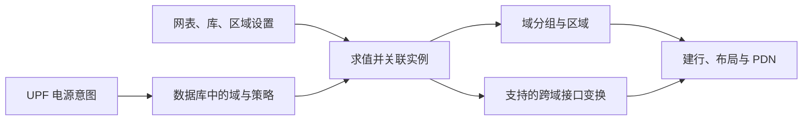

# UPF 模块总览：把电源管理意图接入物理实现

`upf` 读取和维护 Unified Power Format（统一电源格式）描述的电源意图，并把当前实现所支持的策略落实到 OpenDB 对象、区域关系和部分跨域接口电路中。它帮助工具理解“哪些电路一起供电、哪些区域可能断电、跨域信号应该怎样处理”。

本文依据 OpenROAD 提交 `a5a08e8356` 的文档与源码编写。命令入口见 [UPF README](../README.md)。这里讨论当前仓库实现，不把完整 UPF 标准的所有功能都视为本模块已支持。

## 1. 为什么逻辑网表还需要电源意图？

一个芯片可能包含长期工作的控制电路，以及只在需要时工作的计算模块。让计算模块空闲时断电，可以减少功耗；让不同模块使用不同电压，也能在速度和功耗之间取舍。

普通逻辑连接只说明信号由谁产生、送到哪里，没有充分表达断电后的行为。例如，关闭的计算模块输出可能不再有效，但仍供电的控制模块不能因此接收到不确定的控制信号。若两侧电压不同，信号还可能需要电平转换。

UPF 将这些供电意图从普通功能连接中表达出来，供实现流程使用。

## 2. 必须理解的几个概念

| 概念 | 解决什么问题 |
| --- | --- |
| Power domain：电源域 | 指定哪些逻辑实例属于同一组电源管理范围。 |
| Isolation：隔离 | 在源域断电等条件下，将跨域输出钳位为约定的 0 或 1，保护接收域。 |
| Level shifter：电平转换单元 | 使不同供电电压域之间的信号满足接口电压要求。 |
| Power switch：电源开关 | 控制某条供电通路的接通或断开，需要策略与实际库单元映射配合。 |
| Domain area：域的物理区域 | 将逻辑电源域与版图上的放置范围联系起来。 |

逻辑电源域与物理区域有关联，但不是同一件事。域成员可通过层次路径描述；物理区域需要在实现阶段确定。隔离和电平转换也解决不同的问题，同一电压不代表不需要隔离，跨电压也不能仅靠钳位替代接口转换。

## 3. 输入和输出

| 输入 | 提供什么 |
| --- | --- |
| UPF 文件或相应命令 | 电源域、成员、隔离、电源开关和电平转换等策略。 |
| 已读入的设计及层次连接 | 将策略中的路径和端口匹配到实际电路对象。 |
| 单元库与接口单元映射 | 确定可使用的隔离单元、转换单元、开关及相关引脚。 |
| 域电压、控制信号和区域设置 | 决定跨域处理条件及后续放置依据。 |

输出需要区分两个阶段：

1. **读入与记录。** 在数据库中建立电源域、策略、映射等电源意图对象，并支持写出相应 UPF 描述。
2. **求值与实现。** 在流程调用求值逻辑时，将实例组织到域对应的 group/region，并按实现支持的策略插入或连接隔离、电平转换等对象，修改相关网表。

当前 `read_upf` 在 Tcl 层执行文件，不能把“UPF 已读入”直接理解为“所有接口单元和物理供电已经完成”。

## 4. 核心工作：从描述走向实现

**先记录域和策略。** 指定域成员、控制信号、钳位值、单元映射等信息。配置对象存在，只能说明工具记录了信息，还需要后续检查其实现语义。

**再将域与实际实例关联。** 当前核心实现位于 `eval_upf()`。它建立域对应的分组和区域，根据层次路径归属实例，并处理相关连接。IFP 的建行流程是调用该求值逻辑的重要位置之一，因此某些变化会在后续平面规划阶段出现。

**对跨域连接应用受支持的处理。** 隔离需要识别数据、使能和输出引脚，并选择匹配钳位及控制极性的库单元。电平转换需要域电压、转换策略和指定单元/引脚映射等信息。当前求值实现根据域电压关系等条件选择处理分支，并不表示任意隔离与转换组合都会自动完整实现。

**交给物理模块继续落实。** 域内单元需要放入合适区域，电源开关及供电通路要与 PDN 协调，接口单元自身也必须接到正确的供电。UPF 模块不独自铺完电源网格，也不完成所有电源状态的功能验证。

## 5. 典型场景与结果判断

例如，始终上电的控制域 A 连接可关断的计算域 B。B 断电前，需要按设计协议启用隔离，使 A 看到约定的稳定值。如果另一个域 C 使用不同电压，B 与 C 的接口还要按电压关系选择电平转换方案。

评估实现时，需要沿着这条链检查：域成员是否匹配预期实例，区域是否正确，跨域连接是否识别，接口单元及其控制极性是否正确，电源引脚和 PDN 是否对应。接着再用适用的时序和低功耗验证流程检查设计行为。

只看到隔离单元数量增加，不足以说明插在了正确位置；只看到命令没有报错，也不足以证明电源状态行为正确。特别是低功耗标准还包含更广泛的语义，诸如状态保持和复杂状态组合，应逐项核对当前实现与项目所需能力。

修改 UPF 后，还应确认后续求值及已生成的数据库对象如何更新。当前实现存在重建相关的待完善逻辑，不应把重复求值当成天然无副作用的操作；实验适合从明确的设计检查点开始。

## 6. 三类角色的后续学习路径

- **OpenROAD 工具使用者：** 先画出自己的域、供电和跨域信号，再阅读 [isolation.tcl](../test/isolation.tcl) 与 [levelshifter.tcl](../test/levelshifter.tcl)。注意后者重点检查策略读入；应按具体案例区分“读到了策略”和“已完成插入与验证”。结合 [IFP 电源域说明](../../ifp/docs/upf_voltage_domain.md) 理解实现时机。
- **OpenROAD 其他模块开发者：** 从 [upf.h](../include/upf/upf.h)、[upf.cpp](../src/upf.cpp) 和 [InitFloorplan.cc](../../ifp/src/InitFloorplan.cc) 的调用处入手，掌握 power domain、group、region 及实例归属如何传递。自己的模块不能只按区域坐标推断完整电源语义。
- **UPF 模块开发者：** 沿 [upf.tcl](../src/upf.tcl) → [upf.cpp](../src/upf.cpp) → [writer.cpp](../src/writer.cpp) 跟踪读入、求值和写出。重点研究层次成员匹配、控制极性、跨域扇出、同/异电压处理和重复执行，用 [测试目录](../test) 区分解析覆盖与实际电路变换覆盖。
